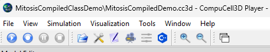
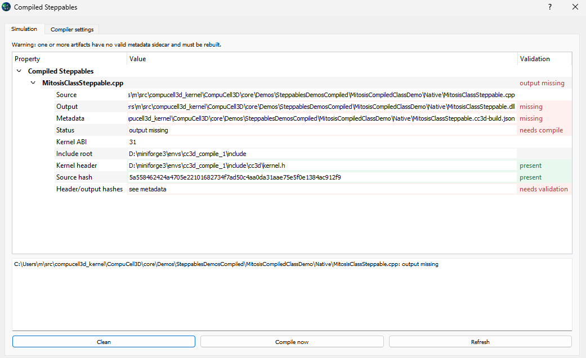
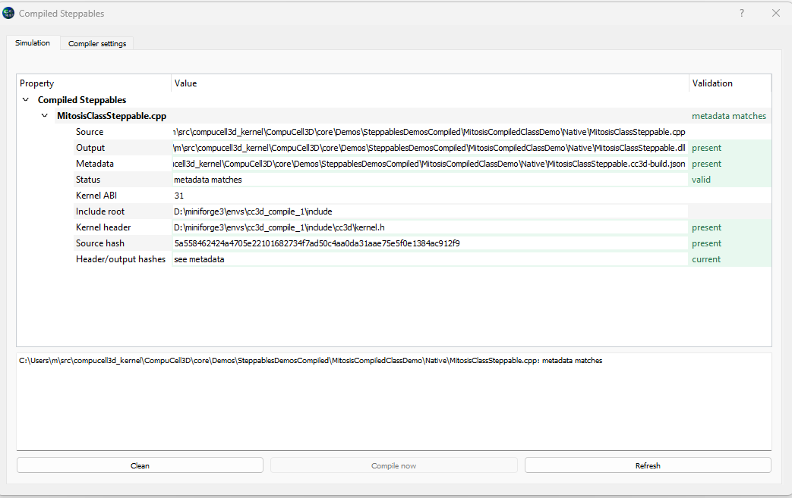
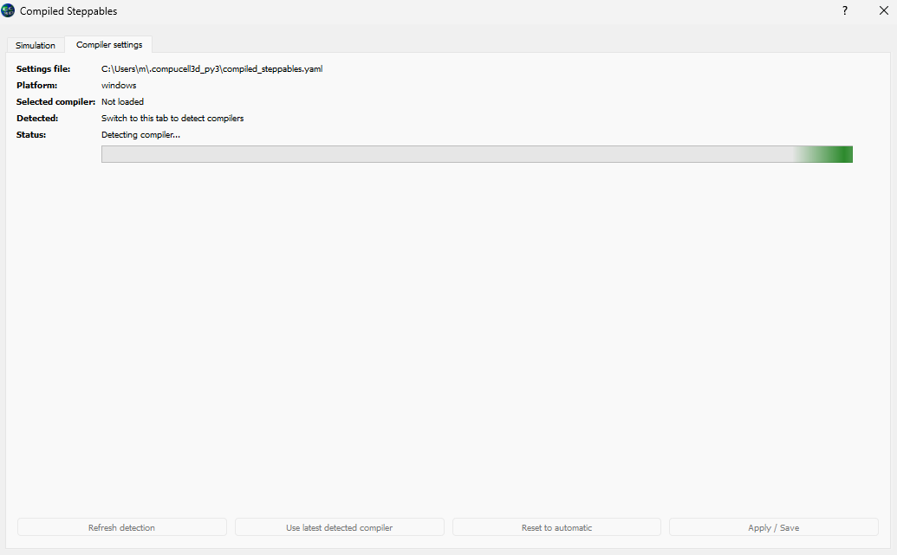
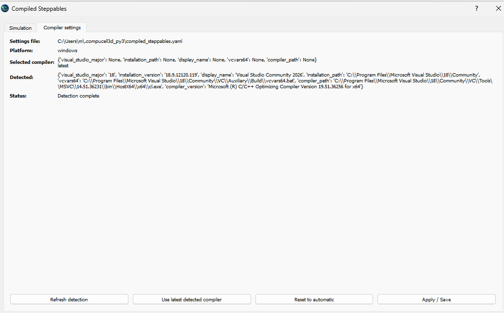

Build, Register, and Run the Steppable
======================================

.. note::

   This page is a practical workflow and can be reused in a user manual.
   Compiler-specific setup is intentionally kept in the existing platform
   build pages.

Project layout
--------------

A small compiled-steppable project can use this layout:

.. code-block:: text

   MySteppable/
     MySteppable.cc3d
     Native/
       MySteppable.cpp
       Utilities/
         Vector2D.cpp
         Vector2D.h
     Simulation/
       MySteppable.py
       MySteppable.xml

The directory containing the declared C++ entry source is the target root. A
target root contains exactly one root-level ``.cpp`` file. Additional
implementation files must be placed in subdirectories. CC3D recursively
discovers nested ``.cpp`` files, compiles them into the target library, tracks
nested ``.h`` and ``.hpp`` files, and adds discovered source directories as
include paths.

A project can contain multiple independent C++ steppables:

.. code-block:: text

   CombinedDemo/
     CombinedDemo.cc3d
     Native_GrowthSteppable/
       GrowthSteppable.cpp
       Utilities/
         Vector2D.cpp
         Vector2D.h
     Native_FieldSteppable/
       FieldSteppable.cpp
       Utilities/
         FieldUtils.cpp
         FieldUtils.h
     Simulation/
       CombinedDemo.py
       CombinedDemo.xml

The project descriptor keeps one C++ resource per target:

.. code-block:: xml

   <Resource Type="Cpp">Native_GrowthSteppable/GrowthSteppable.cpp</Resource>
   <Resource Type="Cpp">Native_FieldSteppable/FieldSteppable.cpp</Resource>

Each resource is compiled independently. Multiple C++ resources sharing one
target root are rejected, and a target containing more than one root-level
``.cpp`` file is rejected. Separate steppables therefore require separate
target roots.

The ``.cc3d`` descriptor names the XML script, Python script, and native C++
resources. The Python script registers each compiled library using a path
relative to the project directory.

Build the native library automatically
--------------------------------------

CC3D automatically compiles compiled steppables for you. When a ``.cc3d``
project declares a C++ resource, CC3D discovers that source, checks whether
its generated library is current, detects or selects a compiler, and builds
the library before the simulation runs. In the normal workflow, you do not
need to invoke ``cl.exe``, ``g++``, or ``clang++`` yourself.

The automatic compiler looks only at C++ resources declared by the active
project. For example:

.. code-block:: xml

   <Resource Type="Cpp">Native/MySteppable.cpp</Resource>

CC3D compares the entry source, all discovered implementation sources, tracked
headers, kernel header, ABI information, metadata, and output library. It
rebuilds when the output is missing, when the discovered source set changes,
or when a tracked input no longer matches the build metadata.

The runtime shared library remains beside the entry source:

* ``.dll`` on Windows;
* ``.so`` on Linux;
* ``.dylib`` on macOS.

All metadata and compiler-generated auxiliary files are stored below the
target root:

.. code-block:: text

   Native_Target/
     Entry.cpp
     Entry.dll
     .cc3d-build/
       Entry/
         Entry.cc3d-build.json
         Entry.obj
         Entry.lib
         Entry.pdb

The exact auxiliary files depend on the platform and compiler. The metadata
records the discovered source and header sets, include directories, compiler
command, hashes, ABI version, platform, machine, and build time. The
``.cc3d-build`` directory is generated automatically and is excluded from
source discovery.

Run with automatic compilation
~~~~~~~~~~~~~~~~~~~~~~~~~~~~~~

Run the project through ``run_script.py`` from the CC3D environment:

.. code-block:: console

   python -m cc3d.run_script \
       --input path/to/MySteppable.cc3d

The same command works with the short input option:

.. code-block:: console

   python -m cc3d.run_script -i path/to/MySteppable.cc3d

Automatic compilation is enabled by default. If the compiler is unavailable
or compilation fails, the simulation does not continue with a stale or
missing compiled steppable.

Control compilation from the command line
~~~~~~~~~~~~~~~~~~~~~~~~~~~~~~~~~~~~~~~~~~

The following switches control the project-scoped compilation workflow:

``--no-compile-steppables``
   Skip automatic compilation. Use this only when the required libraries have
   already been built and you intentionally want to prevent a rebuild.

``--force-compile-steppables``
   Compile every C++ steppable resource even when the output appears current.

``--clean-compiled-steppables``
   Remove generated artifacts for the C++ resources declared by the project
   and exit without running the simulation.

``--clean-and-compile-steppables``
   Remove generated artifacts, force a complete rebuild, and then run the
   simulation.

For example, to rebuild all native resources before running:

.. code-block:: console

   python -m cc3d.run_script \
       -i path/to/MySteppable.cc3d \
       --clean-and-compile-steppables

The cleanup options operate on the active project resources. They do not scan
unrelated ``Native`` directories elsewhere on the machine. For each resource,
cleanup removes the runtime shared library, its
``.cc3d-build/<library-name>`` directory, metadata, and legacy compiler
artifacts left beside the library by older CC3D versions.

Select compiler inputs from the command line
~~~~~~~~~~~~~~~~~~~~~~~~~~~~~~~~~~~~~~~~~~~~~

The automatic compiler normally uses the detected compiler settings. These
options provide explicit inputs when a project needs a different environment:

``--steppable-include-root <path>``
   Use an explicit include root containing ``cc3d/kernel.h``.

``--steppable-repo <path>``
   Use a CompuCell3D repository as a source-tree fallback for the kernel
   header.

``--steppable-msvc-version <major>``
   On Windows, select a Visual Studio major version such as ``16``, ``17``,
   or ``18``.

``--steppable-macos-toolchain apple|conda``
   On macOS, select the Apple or Conda compiler toolchain.

For example:

.. code-block:: console

   python -m cc3d.run_script \
       -i path/to/MySteppable.cc3d \
       --steppable-repo C:\\src\\CompuCell3D \
       --steppable-msvc-version 18

Compiler detection and cached settings
~~~~~~~~~~~~~~~~~~~~~~~~~~~~~~~~~~~~~~~

CC3D stores compiler settings and detected compiler information in:

.. code-block:: text

   ~/.compucell3d_py3/compiled_steppables.yaml

On Windows this is normally:

.. code-block:: text

   C:\\Users\\<user>\\.compucell3d_py3\\compiled_steppables.yaml

The file is created when settings are first loaded. It contains platform
specific compiler preferences and a ``detected`` record. It is a settings
cache, not a replacement for the compiler installation. Removing it causes
CC3D to create fresh defaults and perform initial detection again.

On Windows, detection searches Visual Studio installations with
``vswhere.exe``, activates each candidate through ``vcvars64.bat``, locates
the x64 ``cl.exe``, and records the compiler version. The default policy is
the latest available Visual Studio installation. Selecting a Visual Studio
major is supported; arbitrary path-based Visual Studio selection is not the
active backend policy.

On macOS, detection searches for ``clang++``. On Linux it searches for
``g++`` and then ``clang++``. The selected path is recorded in the detected
settings.

Detection and project status are separate operations. Project status checks
whether a particular project's source and generated artifacts require a
build. Compiler detection finds or refreshes the compiler information used to
perform that build.

Manage compilation in Player
~~~~~~~~~~~~~~~~~~~~~~~~~~~~

Player provides a **Compiled Steppables** action for inspecting and managing
the native resources in the current project. When Player opens a simulation
that declares one or more C++ resources, the Compiled Steppables toolbar action
becomes available:

   Player enables the compiled-steppables action for a simulation that
   declares C++ resources.

Open that action to inspect the project. The Simulation tab lists each C++
resource and shows whether its output library and metadata are valid. If the
output is missing or the metadata no longer matches the source or kernel
header, the project is marked as needing compilation:

   A project with a missing output is marked ``needs compile``. The view shows
   the source, output, metadata, kernel header, and hash validation details.

Use **Compile now** to build the resources listed by the project. After a
successful build, the output library and metadata sidecar are present and the
status changes to valid:

   A successfully compiled resource reports ``metadata matches`` and ``valid``.

Compiler detection in Player
~~~~~~~~~~~~~~~~~~~~~~~~~~~~

The dialog also contains a **Compiler settings** tab. Detection is lazy: Player
does not probe compilers when the dialog is first created. Detection starts
when the Compiler settings tab is selected, which avoids delaying ordinary
simulation startup. The detection worker runs in a background thread so the
Player interface remains responsive:

   Player reports ``Detecting compiler...`` while the background detection
   worker probes the current platform.

When detection completes, Player displays the settings file, platform,
selected compiler policy, and detected compiler information:

   The detected record includes the Visual Studio major version, installation,
   ``vcvars64.bat`` path, ``cl.exe`` path, and compiler version on Windows.

The **Refresh detection** button repeats detection. **Use latest detected
compiler** selects the latest detected compiler, **Reset to automatic** clears
manual preferences, and **Apply / Save** writes the selected settings.

On Windows, detection searches Visual Studio installations with
``vswhere.exe``. It probes each candidate through ``vcvars64.bat``, locates
the x64 ``cl.exe``, and reads the compiler version. On macOS, detection looks
for ``clang++``. On Linux, it looks for ``g++`` and falls back to ``clang++``.

The settings file shown by Player is normally:

.. code-block:: text

   ~/.compucell3d_py3/compiled_steppables.yaml

The file stores both user preferences and the latest detected compiler record.
Detection updates the ``detected`` section while preserving the user's
selection policy. Opening the Compiler settings tab in Player is usually the
most convenient way to detect and select a compiler because it exposes the
result, provides refresh controls, and reports failures without requiring a
simulation run.

The project view reports the status of the C++ resources and can start the
project compilation workflow. Player uses the same project-scoped compiler
selection and build status as the command-line runner. On Windows, compiler
probing may take time because each Visual Studio installation is tested in its
own activated environment; Player performs this work outside the GUI thread.

Command-line compiler detection and selection
~~~~~~~~~~~~~~~~~~~~~~~~~~~~~~~~~~~~~~~~~~~~~~

The command-line runner does not currently expose a separate
``--detect-compiler`` command. Compiler detection is part of the automatic
compilation path. When ``run_script.py`` needs to compile a project, it loads
the settings file, selects a compiler according to the current platform and
selection policy, refreshes detected information as needed, and then builds
the C++ resources.

The usual command is therefore enough:

.. code-block:: console

   python -m cc3d.run_script -i path/to/MySteppable.cc3d

To deliberately exercise the compilation and compiler-selection path, use:

.. code-block:: console

   python -m cc3d.run_script \
       -i path/to/MySteppable.cc3d \
       --force-compile-steppables

To remove prior outputs and perform a clean build:

.. code-block:: console

   python -m cc3d.run_script \
       -i path/to/MySteppable.cc3d \
       --clean-and-compile-steppables

Use ``--steppable-msvc-version 16``, ``17``, or ``18`` to request a specific
Visual Studio major on Windows. Use ``--steppable-macos-toolchain apple`` or
``conda`` on macOS. ``--steppable-include-root`` and ``--steppable-repo``
control where the compiler workflow finds ``cc3d/kernel.h``. The
``--global-settings-dir-name`` option changes the settings directory name
under the user's home directory when a separate compiler-settings profile is
needed.

The command-line runner prints a compiled-steppable summary for each declared
C++ resource. The summary reports whether the resource was compiled or
skipped and gives the reason, such as ``output missing``, ``source changed``,
``kernel ABI changed``, or ``metadata matches``. ``--no-compile-steppables``
skips this automatic path entirely, so it is not a compiler-detection command.

Manual compiler invocation for diagnostics
~~~~~~~~~~~~~~~~~~~~~~~~~~~~~~~~~~~~~~~~~~~

Direct compiler commands are useful when diagnosing a toolchain or testing a
minimal command outside CC3D, but they are an advanced fallback. The command
must compile the native ``.cpp`` file as C++17 or later, include the directory
containing ``cc3d/kernel.h``, produce a shared library or DLL, and place the
output where the Python registration script expects it.

Direct compiler commands do not perform CC3D's recursive source discovery. If
the target contains auxiliary implementation files, list every ``.cpp`` file
explicitly and add the target's source directories to the include path. The
automatic CC3D workflow is usually simpler because it derives this source set
from the declared C++ resource.

On Windows, a representative MSVC command is:

.. code-block:: console

   cl.exe /O2 /std:c++17 /EHsc /LD \
       Native\MySteppable.cpp \
       /I<CC3D_ENV>\include \
       /Fe:Native\MySteppable.dll

On Linux, the corresponding shape is:

.. code-block:: console

   c++ -O2 -std=c++17 -fPIC -shared \
       Native/MySteppable.cpp \
       -I<CC3D_ENV>/include \
       -o Native/libMySteppable.so

The library basename registered by Python must match the produced library.
CC3D's path helper adds the platform-specific suffix when appropriate.

Register the library
--------------------

Use ``register_compiled_steppable`` in the Python simulation script:

.. code-block:: python

   from cc3d import CompuCellSetup

   CompuCellSetup.register_compiled_steppable(
       library_path="Native/MySteppable",
       frequency=1,
   )

``frequency=1`` calls ``step`` after every MCS. A larger frequency reduces the
number of calls and is useful for work that does not need to run every MCS.

Run the simulation
------------------

Run the simulation from the same environment used to run or automatically
compile the CC3D package:

.. code-block:: console

   python -m cc3d.run_script -i path/to/MySteppable.cc3d

The project can also be opened in Player, which can inspect the project,
detect the compiler, and manage compilation through the Compiled Steppables
dialog. If the library fails to load, first check the path, filename,
architecture, and runtime environment before debugging the C++ implementation.

Build verification checklist
----------------------------

* The compiler uses the intended ``cc3d/kernel.h``.
* The ABI version in the header matches the CC3D runtime.
* The output library exists beside the path registered in Python.
* The library exports ``cc3d_get_steppable_v1``.
* The Python process can load the library and its dependent runtime DLLs or
  shared libraries.
